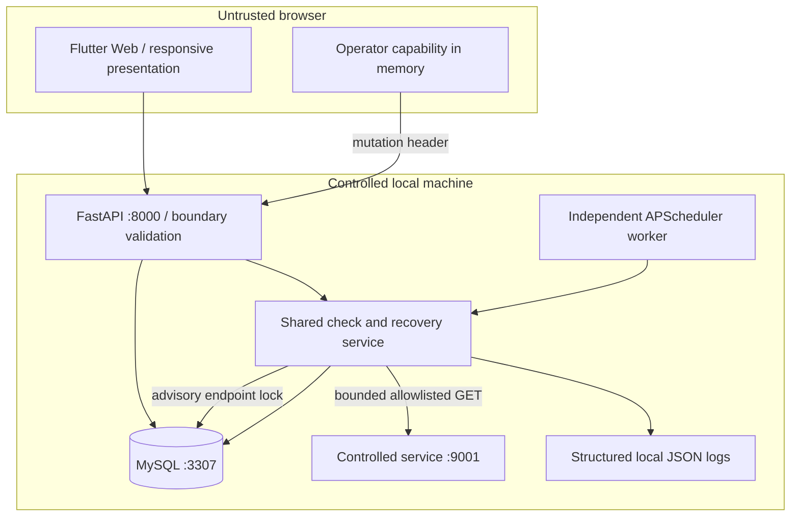
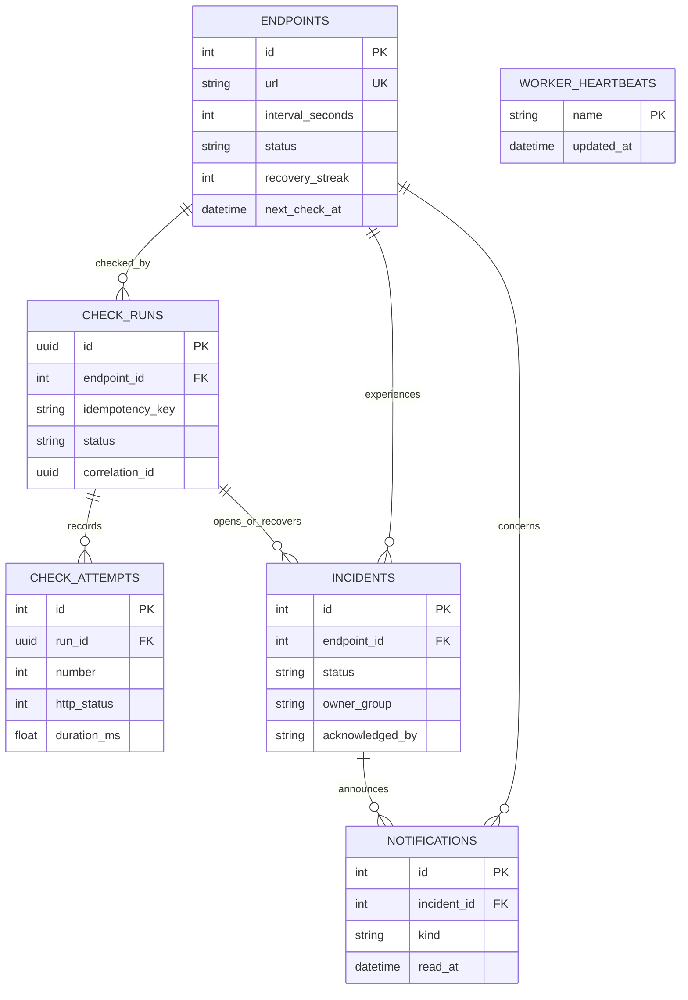

# Architecture and data model

## Components and alternatives

Flutter is the required browser client. FastAPI exposes the application contract; one separate APScheduler worker runs the same monitoring service. MySQL is the user's chosen persistence engine. SQLAlchemy separates storage from API and monitoring logic. HTTPX performs allowlisted health requests with TLS verification enabled for HTTPS and redirects disabled.



Decisions and rejected alternatives are recorded in `week13-design.md`: interval vs browser/event triggers; a single worker vs distributed queue; bounded retries vs continuous retries. SQLite was discussed before the user's explicit MySQL choice. The actual implementation and evidence use MySQL, with no SQLite fallback.

## Entity relationships



MySQL `DATETIME(6)` stores naive UTC with microsecond precision. This avoids near-future rounding of immediately due checks. API serialization explicitly appends `Z`. The schema is generated in `database/schema.sql`; the composite `(endpoint_id,idempotency_key)` and `(run_id,number)` constraints prevent duplicate submissions/attempt numbers.

## Failure and recovery sequence

```mermaid
sequenceDiagram
  participant W as Worker or manual API
  participant M as Monitoring service
  participant D as MySQL
  participant S as Controlled service
  participant H as Support via Flutter
  W->>M: Check endpoint
  M->>D: Acquire endpoint lock; persist running record
  loop Up to three total attempts
    M->>S: Bounded GET
    S-->>M: 503 / timeout
    M->>D: Persist attempt
  end
  M->>D: Failed cycle + one incident + human-action notification
  M->>D: Release lock
  H->>D: Acknowledge through protected API
  H->>S: Repair controlled dependency
  W->>M: Next check
  S-->>M: 200
  M->>D: Recovery streak 1; incident remains active
  W->>M: Following check
  S-->>M: 200
  M->>D: Mark recovered + one recovery notification
```

Credentials cross only the local operator boundary or server-side MySQL connection. Logs contain identifiers/outcomes, not credentials, headers, query strings or dependency response bodies. Local HTTP, shared capability and read-only unauthenticated lab views are explicit residual risks for Week 14.
