# Incident lifecycle

Status: implemented. At most one OPEN or ACKNOWLEDGED incident exists for an endpoint.

```mermaid
stateDiagram-v2
    [*] --> OPEN: Completed failed check and no active incident
    OPEN --> OPEN: Another completed failure; reuse incident
    OPEN --> ACKNOWLEDGED: Operator accepts responsibility
    ACKNOWLEDGED --> ACKNOWLEDGED: Failure or repeated acknowledgement
    OPEN --> RECOVERED: Committed passing check
    ACKNOWLEDGED --> RECOVERED: Committed passing check
    RECOVERED --> [*]: Retain immutable incident history
```

Opening inserts one support notice. Recovery inserts one recovery notice with the passing run ID. A fixture repair changes no incident state. Acknowledgement changes no health result. Interrupted/storage-failed runs cannot recover an incident. A new outage after recovery creates a **new incident ID**; it does not reopen or overwrite the recovered record. A transient run that ultimately passes creates no incident when none was already active.
