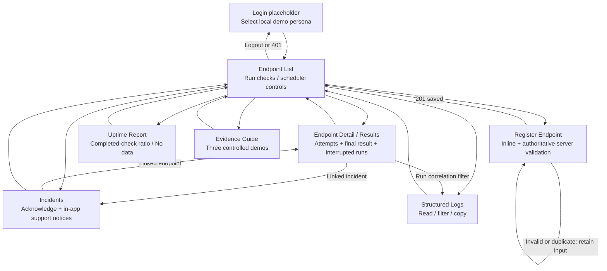

# Screen navigation

Status: implemented Flutter Web navigation, first sketched in Stage 1 from the HTML prototype. See [screen details and states](../flutter-screen-flow.md).

All protected screens follow the same 401-to-login rule. A 403 retains the readable view and explains the missing demo capability. Network/server errors retain input or last confirmed state and provide safe retry feedback. Run completion updates data without requiring navigation to a separate success page. A viewer can navigate read views but cannot mutate server state.
