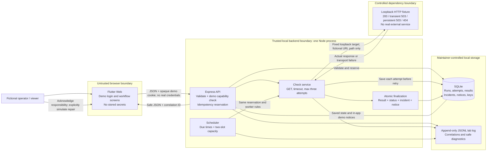

# Boundary and data-flow diagram

Status: implemented local Module 13 architecture, originally drawn before code. Node/Express, SQLite, the controlled fixture, and Flutter are present; see the evidence index for observed execution. No external deployment is claimed.

The browser is not a trusted authority for roles, results, or recovery. The server-side demo session is a placeholder rather than a real credential system. All records are fictional; no personal data or dependency secrets are needed. Local filesystem contents remain maintainer-controlled. DB and log sinks are separate, so reconcile them rather than claiming a cross-file atomic commit. Exceptional paths return safe API errors and retain evidence; storage failure pauses automation.
