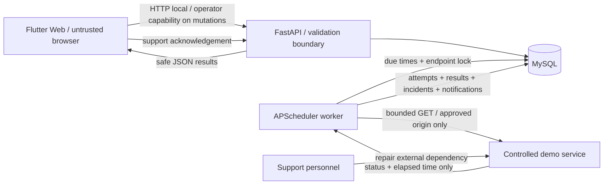
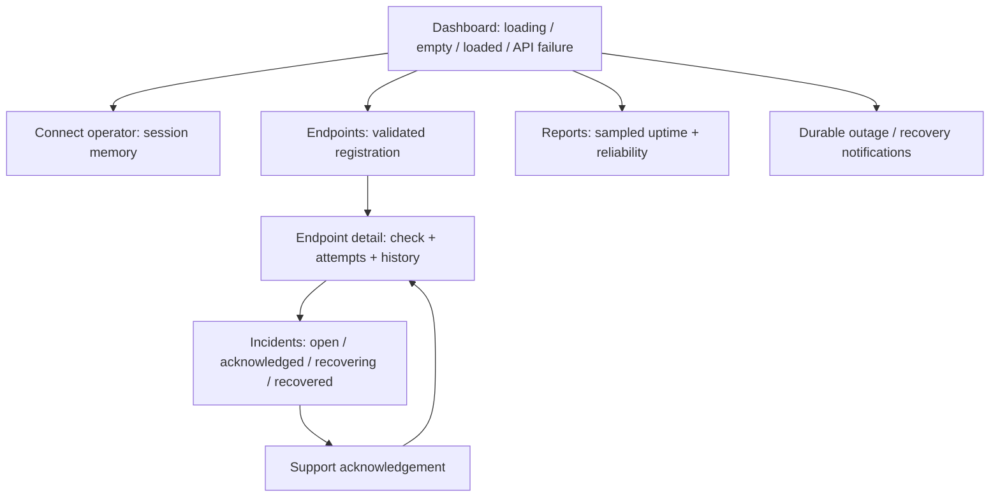

# Week 13 / SA7: design baseline

Project: API Health Monitoring Dashboard, named **Pulsewatch** in the interface.
Primary academic reference: `PFEBSIT_002_Weeks_13-18_Student_Module_Flutter_Web.docx`, Module 13, Advanced Automation and Scripting. The user's approved project adapts the module's generic office scenario to service monitoring. User decisions: Flutter Web, FastAPI, **MySQL**, Week 13 first.

## Boundary and ownership

Developers register only approved, controlled service endpoints. The independent Python worker schedules GET checks, captures bounded results, retries transient failures, opens incidents, and publishes durable in-app notifications. Support acknowledges incidents and fixes the external dependency; the system verifies recovery. Supervisors review sampled uptime and execution history. The API and worker own monitoring records, not repairs to monitored services.

Trusted inputs: server-side allowlist, generated operator capability, validated endpoint settings, server timestamps. Browser input and service responses are untrusted. No response bodies, credentials, production URLs, or personal records are stored in monitoring evidence.

Non-goals for SA7: production rollout, email/SMS, mobile packaging, multi-tenant monitoring, full user accounts/JWT/RBAC from Week 14, and Week 16 load certification. The Week 13 access control is a generated local operator capability; it is not a completed Week 14 authentication system.

## Acceptance criteria fixed before implementation

| ID | Expected behavior |
| --- | --- |
| SA7-01 | Valid registration persists in MySQL; duplicate URL returns 409. |
| SA7-02 | Invalid URL, unapproved origin, credentials/query/fragment in URL, or interval outside 15–3600 seconds is rejected with 422. |
| SA7-03 | A mutation without the operator key returns 401 and makes no change. |
| SA7-04 | Healthy controlled service produces one successful attempt and a persisted result. |
| SA7-05 | Controlled transient 503 recovers on the second attempt; logs and attempts show the same run/correlation identifiers. |
| SA7-06 | Persistent 503 stops after three attempts, creates one incident and a human-action notification. Subsequent failures reuse that incident. |
| SA7-07 | Acknowledgement records the responsible support alias. Acknowledgement alone cannot mark a service recovered. |
| SA7-08 | An open incident requires two consecutive successful check runs to close; an intervening failure resets the streak. One recovery notification is persisted. |
| SA7-09 | Same endpoint/idempotency key returns the recorded run. Concurrent attempts for an endpoint are excluded by a MySQL advisory lock. |
| SA7-10 | A worker, independent of the browser, runs due endpoints, persists its heartbeat, coalesces missed checks, and resumes due work after restart. |
| SA7-11 | Reports show successful completed check cycles / all completed cycles, retry counts, incidents and timing. An endpoint without samples has unknown uptime. |
| SA7-12 | Flutter shows loading, empty, success, validation, unauthorized, API unavailable, incident, and recovery states at desktop and narrow widths. |

## Trigger decision / ADR-001

Selected: interval polling with APScheduler in one separate worker process and due times persisted in MySQL. Availability must be checked when no browser is open, and the controlled services do not provide trustworthy failure events. Fixed-delay scheduling sets the next due time after a completed run; missed intervals are not replayed in a burst. The database is the source of truth for enabled state and schedule.

Alternatives: a browser timer is easy but stops when the tab closes; event/webhook triggers are efficient but require monitored services to emit trusted events even during an outage; a distributed task queue improves scale but adds infrastructure beyond this prototype. Revisit the single-worker decision when check latency or endpoint count exceeds the measured capacity. A scheduled job checks the latest registration state at execution time.

## Retry and recovery policy / ADR-002

- GET only; redirects disabled. Exact scheme/host/port must match the backend allowlist. No credentials, query strings or fragments in registered URLs.
- Timeout: configurable 1–10 seconds per attempt, default 3. An outer asynchronous deadline bounds the whole attempt, not just one socket phase.
- Maximum three total attempts: one initial attempt plus two retries. Retry network/timeout errors and HTTP 408, 429, or 5xx. Other unexpected HTTP statuses fail without retry.
- Backoff: `RETRY_BASE_SECONDS × 2^(retry number − 1)`; default waits 0.5 and 1 seconds. No recursive or indefinite retry.
- A failed cycle opens one incident immediately. Human action is a durable in-app notification assigned to the configured support group; delivery does not depend on an email provider.
- Recovery requires two consecutive successful **cycles**, not two retry attempts. Successful retry before any outage is a recovered transient failure, not a verified incident recovery.
- The worker and manual requests share the same service and MySQL lock. Idempotency keys deduplicate manual submissions. Interrupted work is visible as an unfinished run and reconciled when the endpoint is checked again; no automatic successful result is invented.

## Data flow and trust boundaries

Local HTTP is a controlled lab limitation. HTTPS and individual identities remain Week 14 work. The operator capability lives in backend configuration and browser session memory, never compiled into Flutter or written to evidence. Raw diagnostic logs are local and ignored; sanitized evidence is exported separately.

## Flutter screen flow

Reusable UI: status pill, metric card, service row, empty/error panel, endpoint form, run history and incident card. Narrow screens use a drawer and stacked cards; broad screens use a persistent sidebar. The server remains authoritative for validation and permissions.

## Evidence plan

Backend tests and the HTTP demonstration must generate time-stamped expected/actual evidence. Controlled fixtures: healthy, transient-first-attempt-503, persistent-503 with explicit repair control, and a nonretryable failure. UI widget tests cover real state rendering; browser screenshots support the running API workflow. No stakeholder/UAT or production readiness claims are made in SA7.
